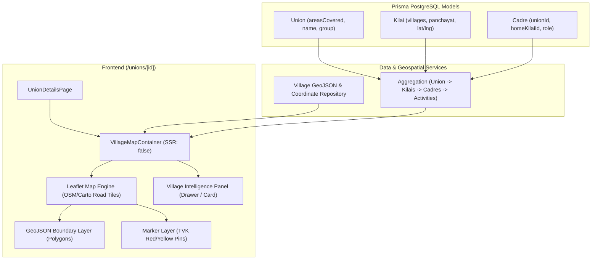

# Interactive Village Map Feature Specification & Implementation Plan

**Project:** TVK Connect (TVK Command Centre)  
**Target Page:** Union Details Page (`/unions/[id]`)  
**Status:** Planned / Specification Complete  
**Date:** October 2026  

---

## 1. Overview & Business Objective

The **Interactive Village Map** is a field-intelligence feature designed for TVK Connect to give party leadership, district coordinators, and union secretaries a geographical visualization of party strength and grassroots activity across every revenue village and panchayat within an organizational unit (Union).

### Core Requirements
1. **Normal Road Map Display**: Render a clean, high-contrast, performant road map showing roads, landmarks, and village names.
2. **Interactive Boundaries & Clickable Pins**:
   - Highlight boundary polygons for all villages falling under the union using TVK brand colors.
   - Place clickable pin markers at the center/hub of each village.
3. **Auto-Fit Engine**:
   - Automatically zoom and fit all village boundaries and markers into the map viewport on initial load or union selection.
4. **Contextual Village Intelligence Panel**:
   - On selecting any pin or boundary polygon, display:
     - Village Name (English & Tamil)
     - Total Kilais count & list with status and Secretary details
     - Total Cadre count and wing breakdown
     - Recent party activities (meetings, campaigns, welfare camps, protests)
5. **Union Details Page Integration**: Seamlessly integrated into the `/unions/[id]` route matching the existing design system and bilingual (`ta`/`en`) support.

---

## 2. Technical Stack & Architecture

### Recommended Tech Stack
| Component | Technology | Rationale |
| :--- | :--- | :--- |
| **Mapping Engine** | `leaflet` (`^1.9.4`) + `@types/leaflet` | Lightweight (~140KB), zero-cost, no API key/quota limits, native GeoJSON polygon support, reliable in React 19. |
| **Map Tiles (Road Map)** | OpenStreetMap / CartoDB Voyager | Standard road map showing streets, junctions, place names in Tamil & English. |
| **Integration Pattern** | Native Leaflet via Next.js Dynamic Client Component (`next/dynamic` with `ssr: false`) | Guarantees zero SSR window issues and eliminates third-party wrapper peer-dependency conflicts with React 19. |
| **Frontend Framework** | Next.js 16 (App Router), React 19, Tailwind CSS v4, Lucide Icons | Matches current TVK Connect stack. |
| **Backend & Database** | NestJS, Prisma ORM, PostgreSQL | Connects existing `Union`, `Kilai`, and `Cadre` models. |

### System Diagram


---

## 3. Data Model & Aggregation Schema

### TypeScript Interface
```typescript
export interface VillageMapData {
  id: string;                      // Normalized slug, e.g. "karaikadu"
  name: string;                    // "Karaikadu"
  tamilName: string;               // "காரைக்காடு"
  unionId: string;                 // Union UUID
  unionName: string;               // "South East Union"
  districtName: string;            // "Cuddalore"
  center: [number, number];        // [lat, lng], e.g. [11.688, 79.756]
  boundary: GeoJSON.Polygon | GeoJSON.MultiPolygon; // Village perimeter polygon
  kilaiCount: number;              // Number of active kilais
  kilais: Array<{
    id: string;
    name: string;
    tamilName?: string;
    secretaryName?: string;
    status: 'ACTIVE' | 'INACTIVE' | 'PENDING';
  }>;
  cadreCount: number;              // Total registered cadres
  cadresByWing?: Record<string, number>;
  recentActivities: Array<{
    id: string | number;
    title: string;
    type: 'MEETING' | 'CAMPAIGN' | 'WELFARE' | 'PROTEST';
    date: string;
    participants: number;
    location: string;
  }>;
}
```

### Geospatial Coordinates (Cuddalore / Kurinjipadi Reference Set)
```typescript
export const UNION_VILLAGE_GEO_DATA: Record<string, { center: [number, number]; boundaryCoords: [number, number][] }> = {
  karaikadu: {
    center: [11.688, 79.756],
    boundaryCoords: [
      [11.695, 79.750], [11.696, 79.762], [11.682, 79.765],
      [11.678, 79.755], [11.683, 79.748], [11.695, 79.750]
    ]
  },
  kudikadu: {
    center: [11.696, 79.761],
    boundaryCoords: [
      [11.704, 79.755], [11.705, 79.768], [11.692, 79.771],
      [11.688, 79.759], [11.704, 79.755]
    ]
  },
  sedapalayam: {
    center: [11.724, 79.742],
    boundaryCoords: [
      [11.732, 79.735], [11.733, 79.748], [11.718, 79.751],
      [11.715, 79.738], [11.732, 79.735]
    ]
  },
  semmanguppam: {
    center: [11.670, 79.753],
    boundaryCoords: [
      [11.678, 79.746], [11.679, 79.760], [11.662, 79.763],
      [11.660, 79.749], [11.678, 79.746]
    ]
  },
  pachaiyanguppam: {
    center: [11.718, 79.769],
    boundaryCoords: [
      [11.725, 79.762], [11.726, 79.776], [11.710, 79.778],
      [11.708, 79.764], [11.725, 79.762]
    ]
  }
};
```
*Note: A dynamic bounding-perimeter generator will automatically construct a smooth polygonal boundary around any newly added village centroid where pre-surveyed polygons are not yet loaded.*

---

## 4. UI / UX Design & Union Details Page Layout

### Placement in `/unions/[id]/page.tsx`
```
+-------------------------------------------------------------------------------+
|  < [Back]  South East Union / தென்கிழக்கு ஒன்றியம்         [+ Register Admin] |
+-------------------------------------------------------------------------------+
|  [ Total Kilais: 7 ]     [ Total Booths: 18 ]      [ Total Admins: 18 ]       |
+-------------------------------------------------------------------------------+
|  VILLAGE MAP & FIELD OVERVIEW / கிராம வரைபடம் & கள நிலவரம்                   |
|  [Search Village...           ]   [ Fit View / அனைத்தையும் காண்க ]            |
|  +--------------------------------------------+-----------------------------+ |
|  |                                            | SELECTED VILLAGE DETAILS    | |
|  |            MAP CANVAS (70%)                | Karaikadu / காரைக்காடு      | |
|  |                                            | --------------------------- | |
|  |    (Normal Road Map - OSM / Carto)         | Kilais in Village: 3        | |
|  |                                            | - Ak Karaikkadu (Active)    | |
|  |     [Polygon 1]                            | - K.Pudur (Active)          | |
|  |       [Pin]                                | - Pillaiyarmedu (Active)    | |
|  |                                            | --------------------------- | |
|  |             [Polygon 2]                    | Cadres: 12                  | |
|  |               [Pin]                        | --------------------------- | |
|  |                                            | Recent Activities:          | |
|  |                                            | * Kilai Meet (2026-08-01)   | |
|  |                                            | * Flag Hoisting (2026-08-10)| |
|  +--------------------------------------------+-----------------------------+ |
+-------------------------------------------------------------------------------+
|  AREAS COVERED (Pills)                                                        |
+-------------------------------------------------------------------------------+
|  ORG UNIT ADMINISTRATORS (Cadre Cards Grid)                                   |
+-------------------------------------------------------------------------------+
```

### Visual Styling (TVK Brand System)
- **Road Map Base**: Crisp Carto Voyager / OpenStreetMap standard road layer.
- **Village Boundaries**:
  - Default: Border `2px` solid `#8F0A1B` (TVK Red/Maroon), Fill: `rgba(143, 10, 27, 0.12)`.
  - Hover: Border `3px` solid `#FFD200` (TVK Gold), Fill: `rgba(255, 210, 0, 0.28)`.
  - Selected: Border `3px` solid `#8F0A1B` with glowing drop shadow, Fill: `rgba(143, 10, 27, 0.35)`.
- **Village Markers (Pins)**:
  - Custom HTML SVG Pin: TVK Maroon teardrop pin with TVK gold center emblem.
  - Active Pin: Pulsing animation ring (`animate-ping`).

---

## 5. Auto-Fit View Engine

When the map loads or when the user clicks **"Fit All / அனைத்தையும் காண்க"**:
```typescript
export function autoFitAllVillages(map: L.Map, villages: VillageMapData[]) {
  if (!map || villages.length === 0) return;

  const bounds = L.latLngBounds([]);
  villages.forEach((village) => {
    bounds.extend(village.center);
    if (village.boundary && village.boundary.coordinates) {
      const coords = village.boundary.coordinates[0];
      coords.forEach((coord: [number, number]) => {
        bounds.extend([coord[1], coord[0]]); // [lat, lng]
      });
    }
  });

  if (bounds.isValid()) {
    map.fitBounds(bounds, {
      padding: [40, 40],
      maxZoom: 15,
      animate: true,
    });
  }
}
```

---

## 6. Implementation Checklist (For Future Execution)

- [ ] **Step 1: Install Dependencies**
  ```bash
  cd frontend
  npm install leaflet
  npm install -D @types/leaflet
  ```
- [ ] **Step 2: Create Geospatial Service & Data Store**
  - Path: `frontend/src/lib/geo/village-geo-data.ts`
  - Defines coordinates, GeoJSON boundaries for all Cuddalore / Kurinjipadi areas.
- [ ] **Step 3: Create Village Map Component**
  - Path: `frontend/src/components/maps/village-map-container.tsx`
  - Implements Leaflet instance with custom pins, polygon layers, tooltips, and click listeners.
- [ ] **Step 4: Create Village Intelligence Detail Panel**
  - Path: `frontend/src/components/maps/village-intelligence-panel.tsx`
  - Displays Kilai count, Cadre count, and Recent Activities with direct action links.
- [ ] **Step 5: Integrate into Union Details Page**
  - Path: `frontend/src/app/[locale]/(dashboard)/unions/[id]/page.tsx`
  - Uses `next/dynamic` to load `VillageMapContainer` with `ssr: false`.
- [ ] **Step 6: Update Localization Files**
  - Add keys for `villageMap`, `fitAll`, `selectVillageHint`, `kilaisInVillage`, `cadresInVillage`, `recentActivities` in `frontend/messages/ta.json` and `frontend/messages/en.json`.
- [ ] **Step 7: Verification & Testing**
  - Verify boundary hover and click responsiveness.
  - Verify auto-fit bounding box across all desktop and mobile viewports.
  - Verify synchronization between map selection and side panel details.

---

*Document created and saved in repository for future implementation.*
